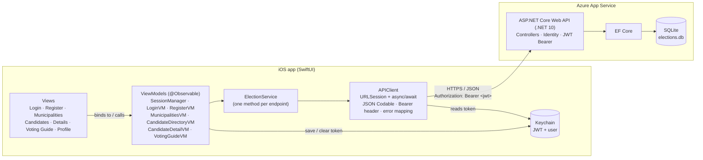

# Municipal Elections Companion (COMP4977 Assignment 1 — Part 2)

SwiftUI iOS app that consumes the Municipal Elections ASP.NET Core Web API.

**Stack:** SwiftUI · MVVM (`@Observable` view models) · async/await · Codable · URLSession · NavigationStack · Keychain JWT storage
**Requirements:** Xcode 16 or later, iOS 17+ simulator or device.

## Run it

1. Open `MunicipalElectionsCompanion.xcodeproj`.
2. Pick an iPhone simulator and press **⌘R**.
3. Sign in with the demo account `demo@elections.ca` / `Demo123!`, or create a new account.

The API URL is set in `App/AppConfig.swift` and points to the Azure deployment.
To run on a physical device, select your Apple ID team under **Signing & Capabilities**.

> If the Azure app is on the Free (F1) plan, the first request after it has been idle can take 20–30 seconds.

## Architecture



| Layer | Responsibility |
|---|---|
| **Models** | `Codable` structs that mirror the API's JSON (`Municipality`, `Position`, `Candidate`, `SavedCandidate`, `AuthResponse`, `ProblemDetails`). |
| **Services** | `APIClient` builds requests, adds the `Authorization: Bearer` header, decodes JSON and maps failures to `APIError`. `ElectionService` exposes each endpoint as a typed `async` method behind the `ElectionServicing` protocol. `TokenStore` keeps the JWT in the Keychain. |
| **ViewModels** | `@MainActor @Observable` classes holding screen state (`LoadState`, form fields, validation errors) and calling the service. `SessionManager` and `VotingGuideViewModel` are app-wide and injected with `.environment`. |
| **Views** | SwiftUI screens; each tab has its own `NavigationStack` with value-based `navigationDestination`. |

### Authentication flow
1. Login/Register calls `POST /api/auth/login` or `/register` and receives `{ token, expiresAt, user }`.
2. `SessionManager.signIn` saves the token in the Keychain; `RootView` switches to the tab bar.
3. Protected calls (`/api/savedcandidates`, `/api/auth/me`) send `Authorization: Bearer <token>`.
4. On launch an unexpired token is restored, so the user stays signed in. A `401` on a protected call signs the user out with a "session expired" message.

## Screens → endpoints

| # | Screen | Shows | API |
|---|---|---|---|
| 1 | Login | Email, password, Log In button, JWT stored in Keychain | `POST /api/auth/login` |
| 2 | Registration | Name, email, password (+ confirm), Create Account | `POST /api/auth/register` |
| 3 | Municipalities | Logo, name, election date (tap for positions & candidates) | `GET /api/municipalities`, `GET /api/municipalities/{id}` |
| 4 | Candidate Directory | Photo, name, position, municipality; search bar; municipality & position filters | `GET /api/candidates`, `GET /api/candidates/search?name=`, `GET /api/positions` |
| 5 | Candidate Details | Photo, biography, website, email; **Add to Voting Guide** | `GET /api/candidates/{id}`, `POST /api/savedcandidates` |
| 6 | My Voting Guide | Saved candidates grouped by municipality; swipe to remove | `GET /api/savedcandidates`, `DELETE /api/savedcandidates/{id}` |
| 7 | Profile | Logged-in user, saved count, Log Out | `GET /api/auth/me` |

## Validation & error handling
- **Required fields:** name, email, password, confirm password.
- **Email format:** regex check before calling the API.
- **Password minimum length:** 6 characters (same rule as the API's Identity settings); register also checks that both passwords match.
- **API errors:** RFC 7807 problem details from the API are decoded and shown (e.g. "Invalid email or password.", "An account with this email already exists.", Identity validation messages).
- **Network errors:** offline, timeout and unreachable-host errors get friendly messages, and list screens show a **Try Again** button. Pull-to-refresh is available on every list.

## Project structure
```
MunicipalElectionsCompanion/
  App/            App entry point, RootView, AppConfig (API URL)
  Models/         Codable models
  Services/       APIClient, APIError, ElectionService, TokenStore (Keychain)
  ViewModels/     SessionManager + one view model per screen
  Views/          Auth, Municipalities, Candidates, VotingGuide, Profile, Components
  Utilities/      Validators, DateParsing
  Assets.xcassets App icon, accent colour
```
