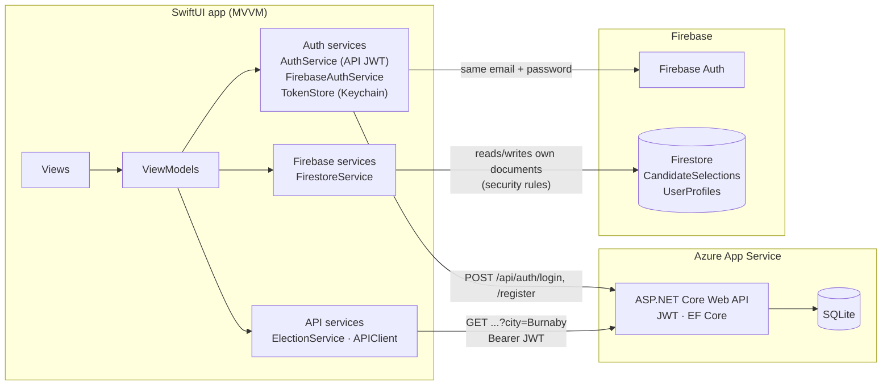

# Municipal Elections Companion (COMP4977 Assignment 2)

SwiftUI iOS app for municipal elections. Election data comes from the ASP.NET Core Web API on Azure;
the user's municipality and candidate selections are stored in **Firebase Firestore**.

**Stack:** SwiftUI · MVVM (`@Observable`) · async/await · Codable · URLSession · NavigationStack / NavigationSplitView · Keychain JWT · Firebase Auth + Firestore SDK
**Requirements:** Xcode 16.2 or later, iOS 17+. Tested targets: iPhone 16 and iPad Air simulators.

## Firebase setup (one time)

1. In the [Firebase console](https://console.firebase.google.com) create a project.
2. **Add an iOS app** with bundle ID `ca.bcit.comp4977.MunicipalElectionsCompanion`, download
   **`GoogleService-Info.plist`** and drop it into the `MunicipalElectionsCompanion/MunicipalElectionsCompanion/`
   folder (next to `App/`). The project uses synchronized folders, so Xcode picks it up automatically.
   The app crashes at launch without this file.
3. **Authentication → Sign-in method →** enable **Email/Password**.
4. **Firestore Database → Create database** (production mode, any region).
5. **Firestore → Rules:** paste the contents of [`firestore.rules`](../firestore.rules) and **Publish**.
6. Open `MunicipalElectionsCompanion.xcodeproj`. Xcode resolves the Firebase package
   (`firebase-ios-sdk`, products FirebaseAuth + FirebaseFirestore) on first open.

Sign in with the demo account `demo@elections.ca` / `Demo123!` or register a new account.

## How the two cloud services fit together



- **Authentication:** login/register call the API, which returns the JWT (stored in the Keychain and sent
  as `Authorization: Bearer`). The app then signs in to **Firebase Auth with the same email and password**
  (creating the Firebase account the first time). That gives Firestore security rules a verified
  `request.auth.token.email`, so each user can only read and write their own documents.
  An expired JWT (401) signs the user out of both.
- **Election data** always comes from the API, scoped to the configured municipality:
  `GET /api/elections?city=`, `/api/offices?city=`, `/api/candidates?city=`, `/api/candidates/search?name=&city=`,
  `/api/candidates/{id}?city=` (404 for another municipality's candidate).

## Municipality configuration

- Mechanism: Firestore document `UserProfiles/<email>` → `{ userEmail, municipalityId, municipalityName, dateModified }`.
- First login: the user must pick a municipality before entering the app.
- Shown on Home (“Municipal Elections Companion — City: Burnaby”), the iPad sidebar, Candidates title,
  My Candidate Selections and Profile. Changed from Home (**Change**) or Profile (**Change Municipality**).
- On change: saved to Firestore → election data, offices and candidates reload → selections are re-queried
  for the new municipality, so the previous municipality's selections are no longer displayed.
- Development/testing municipality: **Burnaby** (also tested with Pitt Meadows and Maple Ridge).

## Firestore data model

**`CandidateSelections`** — document ID `<userEmail>_<candidateId>` (makes duplicates impossible)

| Field | Type | Notes |
|---|---|---|
| id | String | same as the document ID |
| userEmail | String | lower-cased; owner, enforced by rules |
| candidateId | Int | from the API |
| candidateName | String | |
| candidatePhotoUrl | String? | for the list without an API call |
| positionId / positionName | Int / String | |
| municipalityId / municipalityName | Int / String | the app queries by `userEmail` + `municipalityName` |
| notes | String | ≤ 500 characters (app and rules) |
| dateCreated / dateModified | Timestamp | |

**`UserProfiles`** — document ID `<userEmail>`: `userEmail`, `municipalityId`, `municipalityName`, `dateModified`.

## Features

| Area | What it does |
|---|---|
| Login / Registration | API JWT + Firebase Auth sign-in, field validation, friendly API/Firebase errors |
| Home | App title + city, election date, offices with seats and “You've chosen n of N” |
| Candidate Directory | `?city=` data only, search, office filter, adaptive list/grid |
| Candidate Details | API info, **Add Selection**, **Edit Selection** / **Delete Selection** when saved |
| My Candidate Selections | Image, name, municipality, position, notes, date saved; swipe/context-menu edit & delete (confirmation), pull to refresh, grouped by office with seat counts |
| Profile | Email, municipality (view/change), total saved selections, last synchronization timestamp, Sync Now, logout |

**CRUD:** Create (`setData` after a duplicate check), Read (query by user + municipality), Update (`updateData` notes +
dateModified), Delete (confirmation dialog, removed from the UI immediately and restored if Firestore fails).

**Validation:** no duplicate selections; notes ≤ 500 characters (live counter); required candidate/user fields;
the candidate must belong to the configured municipality; **no more selections per office than seats available**
(seat counts from `GET /api/offices?city=`).

**Error handling:** Firestore unavailable/timeout/permission errors, Firebase Auth errors, JWT expiry (auto sign-out),
network failures (offline, timeout, unreachable) and undecodable Firebase/API data all show user-friendly messages.

## Adaptive layout

| | iPhone portrait | iPhone landscape | iPad portrait | iPad landscape |
|---|---|---|---|---|
| Navigation | TabView + NavigationStack | TabView + NavigationStack | NavigationSplitView (sidebar) | NavigationSplitView (sidebar + detail) |
| Candidate Directory | single-column list | 2 columns + bio excerpt & website | multi-column grid | multi-column grid |
| Candidate Details | stacked | photo and info side by side | side by side | side by side |
| Home offices | 1 column | adaptive grid | adaptive grid | adaptive grid |

Techniques: size classes (`horizontalSizeClass` / `verticalSizeClass`), `GeometryReader` column calculation,
`LazyVGrid`, `GridItem(.adaptive)`, `ViewThatFits`, `NavigationSplitView`.

**Orientation changes:** navigation paths and screen view models are owned by `MainView`, above the
iPhone/iPad layout switch; session, municipality and selections are app-wide; the selection editor and
dialogs are presented from outside the size-dependent layout. Rotating keeps the current screen, sign-in,
loaded Firestore data and in-progress notes.

## Project structure

```
MunicipalElectionsCompanion/
  App/                 App entry (FirebaseApp.configure), RootView, AppConfig (API URL)
  Models/              API models (ElectionModels, AuthModels), Firestore models
  Services/API/        APIClient, APIError, ElectionService
  Services/Auth/       AuthService (API JWT), FirebaseAuthService, TokenStore (Keychain)
  Services/Firebase/   FirestoreService, FirebaseServiceError
  ViewModels/          Session, Municipality, CandidateSelections, Home, Directory, Detail/Editor, Auth
  Views/               Auth, Home, Candidates, Selections, Profile, Settings (municipality picker), Components
  Utilities/           Validators, DateParsing
```
